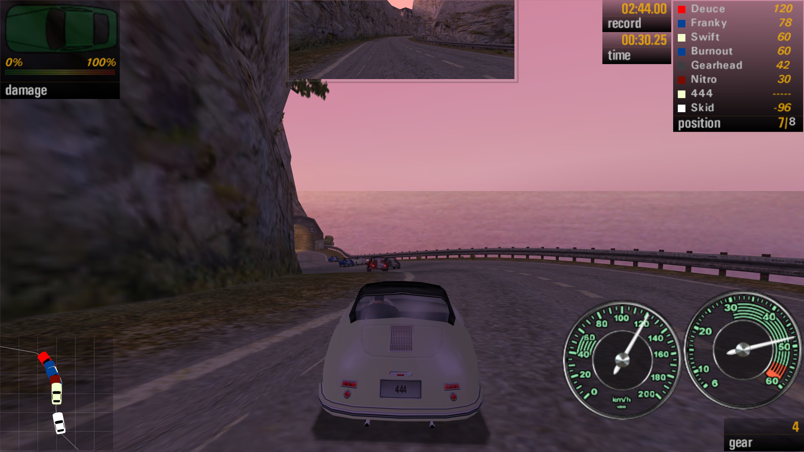
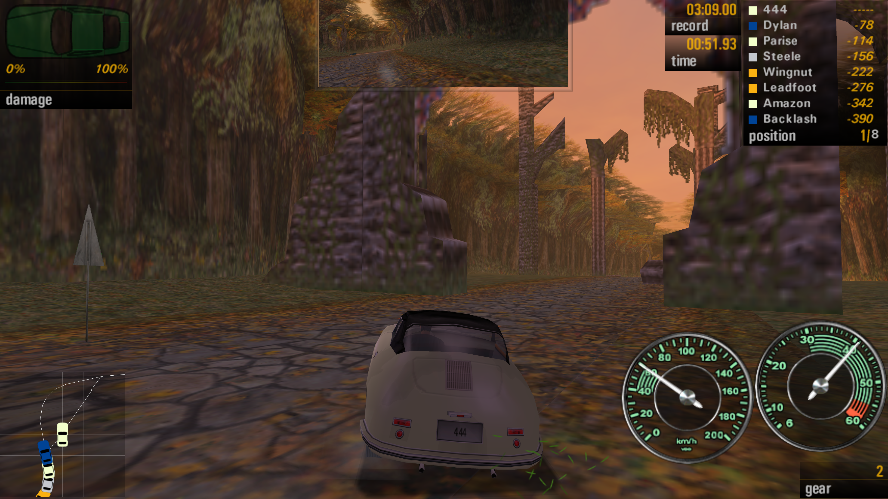
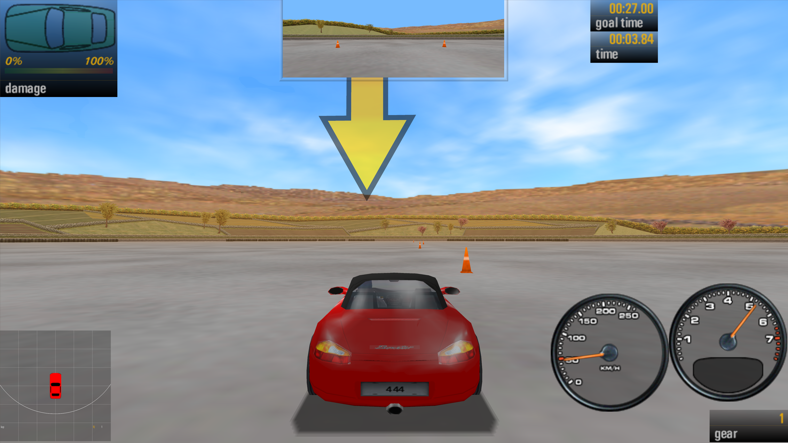
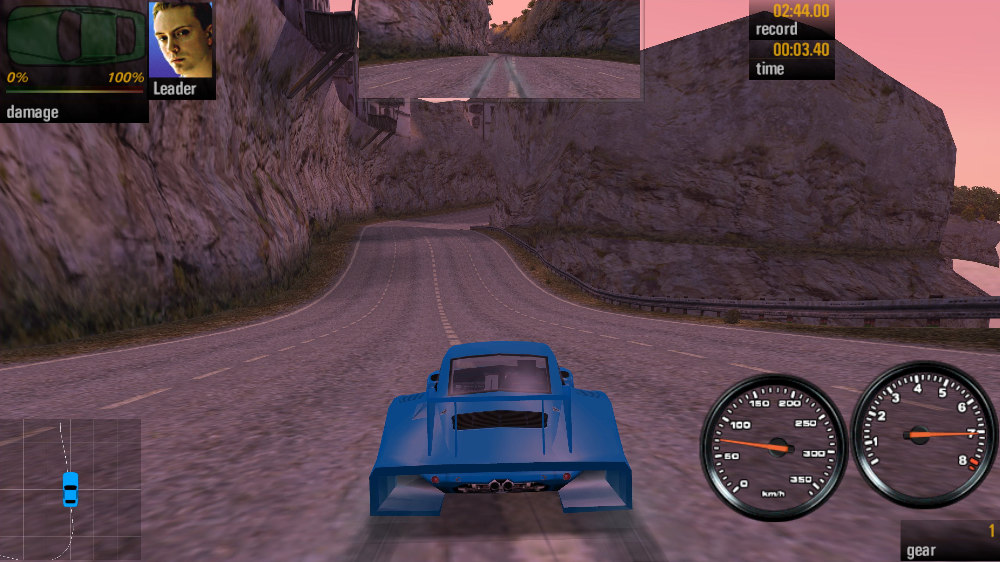

<p align="left">
  
</p>

---

# NFS5 Enhanced (LHedit) - Need for Speed: Porsche Unleashed Enhanced Patch

[](https://github.com/iArtorias/nfs5_enhanced/releases)

> The game you remember, running the way it always should have: wide on any screen,
> smooth at any refresh rate, stable on current Windows, with enhanced Direct3D 11 lighting and water reflections.

> [!IMPORTANT]
> Tested on the **USA** release with the **official v3.5 patch** (`Porsche.exe` with
> MD5 `316F33A59DB48A7DB2A75CC4B3BD03DC`). Any other executable is detected at startup and nothing is hooked,
> so the game runs untouched instead of crashing.

> [!NOTE]
> NFS5 Enhanced (LHedit) is an ASI plugin with its own graphics driver. `Porsche.exe` and the game data are
> never modified on disk, and removing three files restores the original game.

---

## Overview

### Original Mod (`nfs5_enhanced`)
**NFS5 Enhanced** is an *enhanced vanilla* patch for *Need for Speed: Porsche Unleashed*. It deliberately avoids modifying or expanding the game's visuals, lighting, cars, tracks, or graphics features—focusing strictly on broad compatibility, Hor+ widescreen projection, 640x480 HUD scaling, high-refresh-rate simulation interpolation (64 Hz), native SDL3 controller support, and modern Windows 10/11 crash fixes. It introduced a modern replacement Direct3D 11 THRASH driver (`dx11z.dll`).

### LHedit Enhancements (`nfs5_enhanced_LHedit`)
Unlike the original mod which intentionally kept vanilla visuals unchanged, **LHedit** actively expands the visual and rendering features of the game. Built on top of NFS5 Enhanced v1.2.0, LHedit enhances `dx11z.dll` with real-time player and opponent headlight illumination (including high beams), tail/brake/signal light glows, real-time water reflections, special alpha edge (`B4`) and back-face geometry (`B8`) passes, as well as extended Hor+ widescreen sky and world culling hooks.

---

## LHedit Feature Highlights

### Direct3D 11 Lighting & Reflection Enhancements

| Feature | What it does |
|---|---|
| Headlight Illumination | Adds real-time headlight rendering for the player car (including high beams) and opponent cars in Direct3D 11. |
| Tail, Brake & Signal Glows | Adds glow, lens flares, and light projection effects for tail lights, brake lights, and turn signals. |
| Water Reflections | Real-time water reflection pass rendered directly through `dx11z.dll`. |
| Alpha Edge Pass (B4) | Dedicated alpha edge rendering pass (`B4`) for correct transparency edges and foliage alpha testing. |
| Back-Face Pass (B8) | Dedicated back-face pass (`B8`) ensuring correct rendering of double-sided geometry, shadows, and reflections. |
| Diagnostic Measure Log | Detailed performance measuring and pass timing recorded in `dx11z.log` when enabled. |

### Widescreen & Culling Enhancements

| Feature | What it does |
|---|---|
| Hor+ Sky & World Cull Hooks | Widens the half-FOV used during skybox and world geometry culling calculations so distant terrain, objects, and sky elements do not disappear or pop at screen edges on widescreen displays. |

---

## Base NFS5 Enhanced Features

### Direct3D 11 Renderer (`dx11z.dll`)
- Modern Direct3D 11 driver replacing DirectX 7 `dx7z.dll`.
- Multisample antialiasing (up to 8x MSAA) and forced anisotropic filtering.
- Borderless, exclusive fullscreen, or resizable window modes without display resolution drops.
- High-DPI support, VSync control, Alt+Tab focus handling, and crisp 640x480 UI scaling.

### Gamepad & Controls
- SDL3 gamepad support (DualSense, DualShock 4, Xbox, Switch Pro, etc.) with hotplugging and persistent bindings.
- Modern default controller bindings and force-feedback rumble support.

### Widescreen, HUD & Smoothness
- Hor+ aspect ratio correction for 3D cameras and rear-view mirror.
- Sharp font glyph sheet upscaling at 2x/4x resolution.
- Fixed 64 Hz simulation interpolation for high-refresh-rate screens.

### Stability & Draw Distance
- No CD requirement, Windows 10/11 crash fixes, and increased track draw distance.

---

## Screenshots

<table>
  <tr>
    <td align="center"><b>Quick Race</b><br><a href="images/screenshot-quick-race.png"></a></td>
    <td align="center"><b>Evolution</b><br><a href="images/screenshot-evolution.png"></a></td>
  </tr>
  <tr>
    <td align="center"><b>Factory Driver</b><br><a href="images/screenshot-factory-driver.png"></a></td>
    <td align="center"><b>Multiplayer</b><br><a href="images/screenshot-multiplayer.png"></a></td>
  </tr>
</table>

---

## Requirements

- Windows 10 or 11
- **Need for Speed: Porsche Unleashed**, USA release plus official **v3.5** patch applied over
- [Ultimate ASI Loader](https://github.com/ThirteenAG/Ultimate-ASI-Loader) installed as `dinput.dll` in the game folder
- [SDL3](https://github.com/libsdl-org/SDL) (`SDL3.dll`) for gamepad support

---

## Installation

### 1. Get the files
Unzip the release package into a folder.

### 2. Copy into game folder
Copy `nfs5_enhanced.asi`, `nfs5_enhanced.ini`, and `SDL3.dll` next to `Porsche.exe`, and `dx11z.dll` into the `Drivers` directory of the game.

### 3. Play
Run `Porsche.exe`. Options are configured in `nfs5_enhanced.ini`.

---

## New Configuration Options

Common adjustments for new LHedit settings:

| I want | Set |
|---|---|
| Diagnostic measurement and rendering pass logging in `dx11z.log` | `Measure = 1` or `2` under `[Dx11]` |
| Alpha edge transparency fix for foliage and detailed textures | `AlphaEdgeFix = 1` under `[Dx11]` |
| Custom alpha edge reference threshold value | `AlphaEdgeRef = 128` (1 to 255) under `[Dx11]` |
| Force double-sided geometry rendering for back-faces | `ForceTwoSided = 1` under `[Dx11]` |
| Extended FOV culling so sky and scenery don't pop on wide screens | `HorPlus = 1` under `[Widescreen]` |

---

## Troubleshooting

<details>
<summary><b>"DirectX 0" error at startup</b></summary>

Check that `Drivers\dx11z.dll` exists in the game folder. When the selected driver cannot be
loaded the stock `dx7z.dll` is used instead. `ThrashDriver = dx` always uses the stock driver.

</details>

<details>
<summary><b>Black screen or wrong picture with Direct3D 11 driver</b></summary>

`Drivers\dx11z.log` lists the device, the window and every video mode change. Include it in a bug report.

</details>

<details>
<summary><b>The controller does nothing</b></summary>

Check that `SDL3.dll` is next to the ASI and that `nfs5_enhanced.log` lists the pad under "Gamepad connected".

</details>

---

## Building

Visual Studio 2022/2026 with CMake 3.24 or newer:

```bat
cmake -S . -B build -A Win32
cmake --build build --config Release
```

MinGW i686 using toolchain file in `cmake/`:

```bat
cmake -S . -B build-mingw -G Ninja -DCMAKE_TOOLCHAIN_FILE=cmake/mingw-i686.cmake -DCMAKE_BUILD_TYPE=Release
cmake --build build-mingw
```

---

## Credits

- [Silent](https://github.com/CookiePLMonster) for [SilentPatchNFS90s](https://github.com/CookiePLMonster/SilentPatchNFS90s)
- [iArtorias](https://github.com/iArtorias/nfs5_enhanced) for original [nfs5_enhanced](https://github.com/iArtorias/nfs5_enhanced)
- [narzoul](https://github.com/narzoul) for [DDrawCompat](https://github.com/narzoul/DDrawCompat)
- [ThirteenAG](https://github.com/ThirteenAG) for [Ultimate ASI Loader](https://github.com/ThirteenAG/Ultimate-ASI-Loader)
- [SDL Developers](https://libsdl.org) for SDL3
